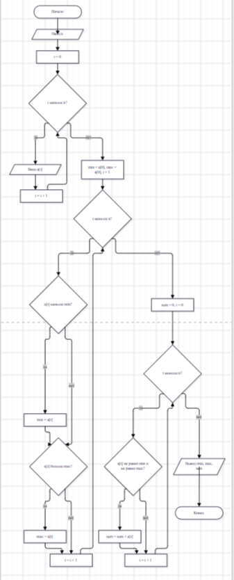

## Домашнее задание к лабораторной 11

### Вариант 11
#### С одномерным массивом, состоящим из n вводимых с клавиатуры положительных и отрицательных целых чисел выполнить следующие вычисления: Сумму элементов массива, за исключением минимального и максимального значения.
```
#define _CRT_SECURE_NO_WARNINGS
#include <stdio.h>
#include <locale.h>

// Лабораторная 11, задание 3 (ДЗ), вариант 11
// Массив из n целых чисел (положительные и отрицательные), вводятся с клавиатуры.
// Найти сумму элементов массива за исключением минимального и максимального значения.
// (не учитываем элементы, равные минимуму или максимуму)

int main()
{
    setlocale(LC_ALL, "Rus");
    int a[100];
    int n, i;
    int min, max, sum = 0;

    printf("Введите количество элементов n (не больше 100): ");
    scanf("%d", &n);

    for (i = 0; i < n; i++)
    {
        printf("a[%d] = ", i + 1);
        scanf("%d", &a[i]);
    }

    // ищем минимум и максимум
    min = a[0];
    max = a[0];
    for (i = 1; i < n; i++)
    {
        if (a[i] < min)
            min = a[i];
        if (a[i] > max)
            max = a[i];
    }

    // суммируем всё, кроме минимального и максимального значения
    for (i = 0; i < n; i++)
    {
        if (a[i] != min && a[i] != max)
            sum = sum + a[i];
    }

    printf("Минимальное значение = %d, максимальное значение = %d\n", min, max);
    printf("Сумма элементов без минимального и максимального = %d\n", sum);

    return 0;
}

```

### Вывод
####Я научилась работать с одномерным массивом, который вводится с клавиатуры. С помощью цикла `for` я заполнила массив и нашла в нём минимальное и максимальное значение. Потом вторым циклом я посчитала сумму элементов, не равных им. Я поняла, что нумерация элементов в языке Си начинается с нуля, поэтому последний элемент имеет индекс `n - 1`. Переменные `min`, `max` и `sum` нужно задавать до циклов, иначе они не будут видны после них. Массив удобно обрабатывать циклом, потому что число элементов известно заранее.